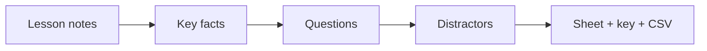

# AI Quiz Generator

> Paste lesson notes, get a ready-to-use quiz with answers, distractors and a printable answer key.

     

**Sector:** Education  ·  **Project 23 of 50** in my [AI Automation Projects series](https://github.com/Princewill106/Princewill106)

## The problem

Teachers spend evenings writing quizzes by hand. Good questions need plausible wrong answers, and making those up for every topic is the slowest part.

## How it works



1. **Read** — Lesson notes come in as plain text (`sample_notes.txt`).
2. **Find facts** — Definition sentences ('X is ...', 'X are ...', 'X refers to ...') are extracted as key facts.
3. **Ask** — Each fact becomes a multiple-choice question ('What is ...?') or a fill-in-the-blank with the term removed.
4. **Distract** — Wrong options are other terms from the same notes, so they're plausible and on-topic.
5. **Export** — Student sheet, answer key and a CSV for Google Forms/quiz tools go to `output/`.

## Features

- Definition-pattern fact extraction
- MCQ and fill-in-the-blank formats
- On-topic distractors
- Shuffled options with seed for reproducibility
- Student sheet, answer key and CSV export

## Quick start

```bash
git clone https://github.com/Princewill106/ai-quiz-generator.git
cd ai-quiz-generator
python main.py --demo
```

No installs needed: it uses only the Python standard library. The demo runs fully offline using the sample data in this repo.

**Optional: plug in an LLM.** Copy `.env.example` to `.env` and add an Anthropic or OpenAI key. The project will then use the model for the language-heavy steps and fall back to its rule-based logic if a call fails.

Run the tests:

```bash
python -m unittest -v
```

## Sample output

```text
# Quiz

1. Which term is the use of technology to perform tasks with minimal human input?
   A. Action
   B. API
   C. Automation
   D. Webhook

2. ________ is the event that starts a workflow, such as a new form submission.

3. Which term is a step the workflow performs after the trigger fires?
   A. Action
   B. Automation
   C. Webhook
   D. Large language model

4. ________ is a URL that receives data from another app the moment something happens.

5. Which term is a set of rules that lets two software systems talk to each other?
   A. Automation
   B. API
   C. Webhook
   D. AI agent

6. ________ is an AI system trained on text that can read and write natural language.

# Answer key

1. Automation
2. Trigger
3. Action
4. Webhook
5. API
6. Large language model

Saved output/quiz.md, output/answer_key.md, output/quiz_forms.csv
```

## Use it in n8n (no code needed)

[`n8n-workflow.json`](n8n-workflow.json) is a ready-to-import n8n version of this project, built for n8n 1.x.

1. In n8n, open **Workflows → Import from File** and choose `n8n-workflow.json`.
2. Click **Test workflow**. It runs the full logic on the sample data built into the *Sample data* node, so you can see the results before connecting anything.
3. Open each output node and connect your accounts. For Google Sheets, pick your spreadsheet and sheet.
4. Adjust the settings at the top of the **Logic** node (thresholds, templates, contacts), then **Activate**.

**Flow:** **Webhook** (`POST /webhook/make-quiz`) → **Logic** (Code node)

**Outputs:**


The Logic node is a JavaScript port of the rules in `main.py`, so you can run the project in n8n without Python.

## Use it on your own data

Save notes as text and run `python main.py --input notes.txt --count 8`. Notes written as clear definitions give the best questions. With an LLM key set, extra higher-order questions are added.

## Project structure

```text
n8n-workflow.json            Importable n8n workflow
.env.example                 Optional API key settings
.gitignore                   Git ignore rules
LICENSE                      MIT license
README.md                    This file
llm.py                       Optional LLM helper (offline fallback)
main.py                      Entry point and core logic
requirements.txt             Dependencies (stdlib only)
sample_notes.txt             Sample input data for the demo
test_main.py                 Unit tests
```

## Who this is for

- Secondary school teachers
- Bootcamp instructors and trainers
- Students revising for exams

## Ideas to extend it

- [ ] Read PDFs and slides
- [ ] Bloom's taxonomy levels
- [ ] Export to Google Forms via API
- [ ] Difficulty tagging from past results

## About

Built by **Ogbu Ugochukwu Princewill**, AI Automation Lead and robotics engineer. I teach people and businesses to build with AI, not just talk about it. [LinkedIn](https://www.linkedin.com/in/ugochukwu-ogbu-653a0816a)

If this helped you, give it a ⭐ and share what you built with it.

## License

MIT — see [LICENSE](LICENSE).
